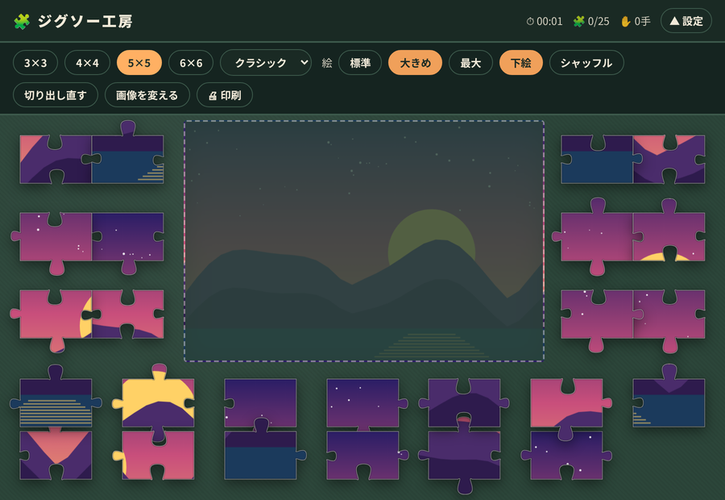
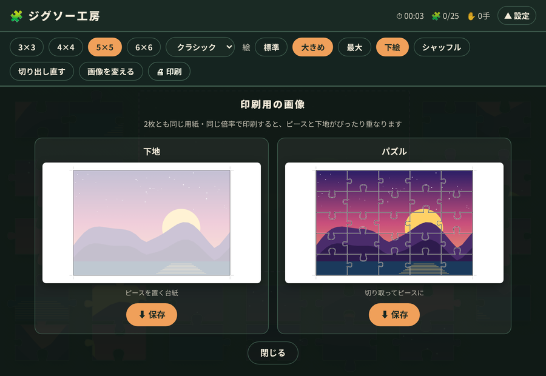

# 🧩 ジグソー工房

手持ちの写真が、そのままジグソーパズルになるブラウザゲームです。
遊んだあとは印刷して、紙のパズルも作れます。

画像はブラウザの中だけで処理され、どこにもアップロードされません。



## 特長

- **好きな写真でパズルになる** — 画像を選ぶとその場でピースに切り分けられます
- **本物のジグソー形状** — ピースの凹凸をベジェ曲線で一枚ずつ生成するので、同じ切り方は二度と出ません
- **4種類の切り方** — クラシック / ランダム / なみなみ / しかく
- **3×3 〜 6×6** の難易度と、**絵の大きさ**を3段階で調整
- **拡大・切り出し** — 2本指のピンチ操作で、写真の使いたい部分だけを切り出せます
- **印刷用の画像を書き出せる** — 下地とパズルの2枚をPNGで保存
- スマホのタッチ操作に対応。完成するとタイムと手数が出ます

## 遊び方

1. 「画像を選ぶ」から写真を選びます（ドラッグ＆ドロップでもOK）
2. 切り出し画面で、ドラッグと2本指のピンチで使いたい範囲を決めます
3. 「この範囲で作成」でパズルが始まります
4. ピースを枠の中の正しい位置へ運ぶと、自動ではまります

「設定」を開くと、分割数・ピースの形・絵の大きさ・下絵の表示を切り替えられます。

## 印刷して紙のパズルにする

「印刷」を押すと、2枚のプレビューが出ます。



| | 内容 | 使い方 |
|---|---|---|
| **下地** | 絵を薄く印刷した台紙 | 切り抜いたピースをこの上に並べます |
| **パズル** | 絵＋切り取り線 | 厚紙に貼って、線に沿って切り抜きます |

- 長辺2400pxで書き出すので、A4いっぱいに印刷しても十分な細かさです
- 切り取り線は白フチ付きの黒線なので、暗い写真でも明るい写真でも線を見失いません
- 四隅にトンボ（位置合わせの目印）が入っています

> **印刷のコツ**
> 2枚とも同じ用紙サイズ・同じ倍率（「用紙に合わせる」など）で印刷してください。
> そうすると、切り抜いたピースと下地がぴったり同じ大きさになります。

## 動かす

### そのまま開く

`index.html` をブラウザで開くだけで動きます。
（Reactを配信サイトから読み込むため、初回だけネット接続が必要です）

### GitHub Pages で公開する

1. このリポジトリをGitHubにアップロードします
2. リポジトリの **Settings → Pages** を開きます
3. **Source** を `Deploy from a branch`、ブランチを `main` / フォルダを `/ (root)` にして保存します
4. 数分後に `https://<ユーザー名>.github.io/<リポジトリ名>/` で遊べます

スマホのホーム画面に追加しておくと、アプリのように開けます。

## 開発

ソースは `src/JigsawKobo.jsx` の1ファイルです。
ブラウザが直接読める `app.js` に変換してから使います。

```bash
npm install     # 最初の一度だけ
npm run build   # src/JigsawKobo.jsx → app.js
```

`app.js` は自動生成されるファイルなので、直接編集せず `src/JigsawKobo.jsx` を編集してください。

### ファイル構成

```
.
├── index.html            ブラウザで開くページ
├── app.js                ビルド済み（build.mjs が自動生成）
├── build.mjs             src → app.js の変換スクリプト
├── package.json
├── src/
│   └── JigsawKobo.jsx    本体。編集するのはここ
└── docs/                 READMEに載せている画像
```

## 技術メモ

- **React 18**（配信サイトから読み込み、ビルドツールなし）
- **ピースの形** — 辺ごとに凸の位置・大きさ・くびれ・傾きを乱数で決め、隣り合う辺は同じ値を共有して反転させることで必ず噛み合うようにしています
- **ピースの描画** — 辺の形からパスを作り、`clip()` で写真を切り抜いて1枚ずつ画像にしています
- **ピースの配置** — 盤面を上寄せにして下に広い余白を作り、そこへ必要な枚数を均等に配置します。「絵の大きさ」はピース同士の間隔を基準に決めるので、写真の向きによらず設定が効きます
- **印刷画像** — ゲーム中と同じ辺の形を保持しておき、印刷用の解像度で描き直しています

## ライセンス

自由に使ってください。公開する場合は MIT License などを添えるのがおすすめです。
